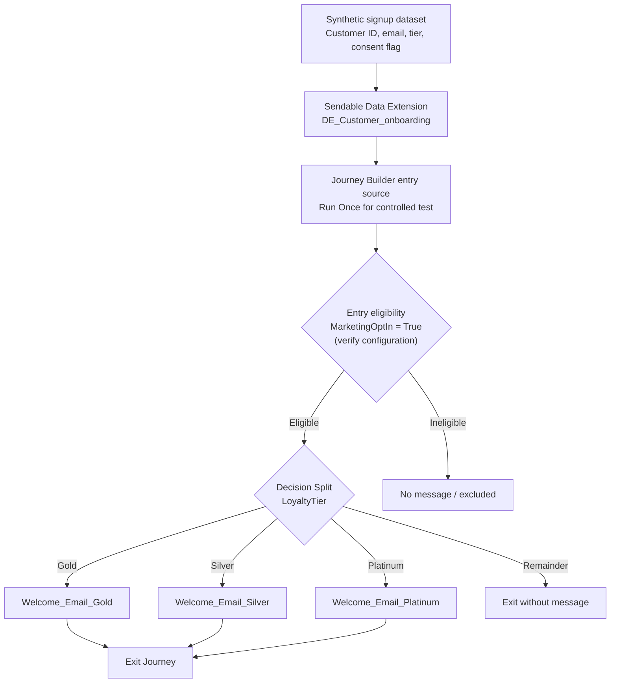
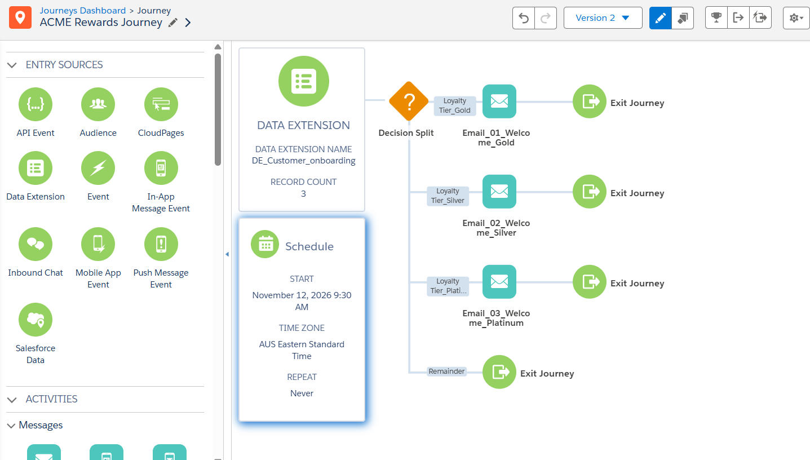
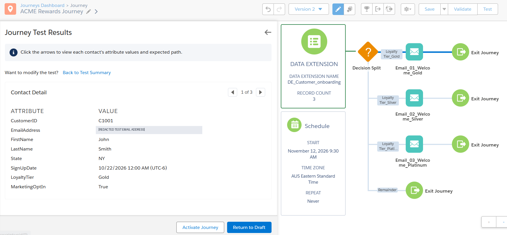
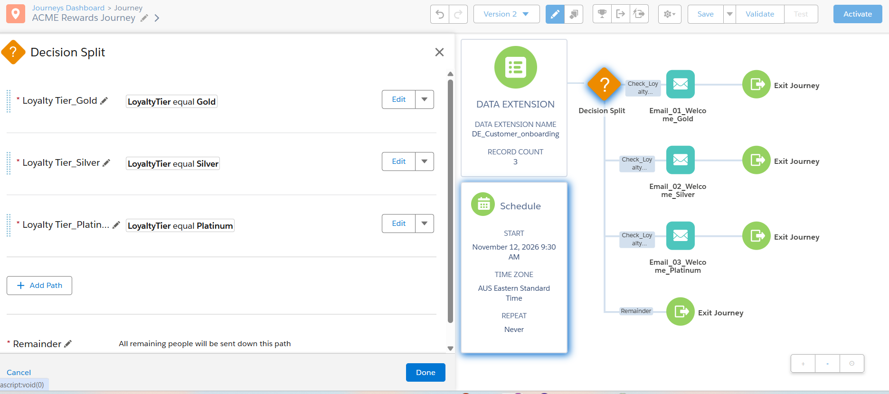
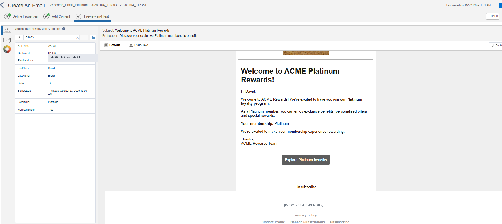

# ACME Rewards | Loyalty-Based Customer Onboarding

**Salesforce Marketing Cloud Engagement · Journey Builder · Content Builder · Data Extensions · Email Personalisation**

> **Portfolio implementation / controlled test environment.** This project demonstrates a configured and validated three-branch onboarding journey using synthetic customer profiles and controlled test addresses. It has **not** been presented as a production deployment, a live campaign, or evidence of delivered email.

## Executive summary

ACME Rewards is a fictional retail loyalty programme. The business needs a repeatable onboarding experience that routes newly registered, marketing-eligible customers to a tier-specific welcome message. This implementation uses a sendable Data Extension as the Journey Builder entry source, a loyalty-tier Decision Split, and three independently configured welcome-email activities.

**Observed outcome:** **3 of 3** synthetic contacts were routed to their expected Gold, Silver, and Platinum branches in **Journey Builder Test Mode (100% test assertion pass rate)**. Content Builder previews resolved the expected first names; all three Message Definitions were checked against their associated branch. Test Mode does **not** send messages and is not evidence of deliverability, engagement, or business uplift.

| Dimension | Implementation |
| --- | --- |
| Use case | New-customer loyalty onboarding |
| Platform | Salesforce Marketing Cloud Engagement |
| Entry source | `DE_Customer_onboarding` (3 test records) |
| Routing attribute | `LoyaltyTier` |
| Branches | Gold, Silver, Platinum, Remainder (exit) |
| Messages | Separate tier-specific Content Builder emails |
| Configuration | ACME Rewards Journey · Version 2 |
| Test evidence | 3/3 simulated paths; personalised email previews; non-blocking validation recommendation |
| Current maturity | **Functional portfolio demonstration; not production-certified** |

## Architecture

The diagram below is rendered from editable Mermaid source, not a screenshot.

**Evidence boundary:** The `MarketingOptIn = True` filter is a design requirement; the provided screenshots do not independently establish that the entry filter is enabled. Validate it before activation. A Boolean flag alone is not consent proof.

See [Architecture and design decisions](architecture/ARCHITECTURE.md) for deployed-vs-proposed boundaries, security and production hardening.

## Implemented components

1. **Data Extension:** `DE_Customer_onboarding`, with eight fields and three imported synthetic customer profiles. CustomerID is the intended stable subscriber identifier; confirm the send relationship in the account before live use.
2. **Journey Builder:** a Data Extension entry source and a Decision Split with `LoyaltyTier = Gold`, `Silver`, `Platinum` and a Remainder exit path.
3. **Content Builder:** a Gold, Silver and Platinum welcome email, each with tier-specific subject, body and CTA label.
4. **Personalisation:** a subscriber-preview greeting using `%%FirstName%%` and an explicitly labelled tier-specific welcome message.
5. **Quality assurance:** validation showed a recommendation to consider High-Throughput Sending but no blocking error in the captured result; 3/3 Journey Builder simulation routes passed.
6. **Traceability:** each journey Email activity is mapped to its corresponding Content Builder Message Definition.

### Branch-to-message contract

| Tier / branch | Journey activity | Verified Message Definition | Preview contact |
| --- | --- | --- | --- |
| Gold | `Email_01_Welcome_Gold` | `Welcome_Email_Gold` | C1001 / John |
| Silver | `Email_02_Welcome_Silver` | `Welcome_Email_Silver - 20261104_111803` | C1002 / Sarah |
| Platinum | `Email_03_Welcome_Platinum` | `Welcome_Email_Platinum - 20261104_111803 - 20261104_112351` | C1003 / David |
| Remainder | No Email activity | N/A; journey exit | Unmatched tiers |

## Test results

| Test | Expected | Observed | Evidence |
| --- | --- | --- | --- |
| Gold routing | C1001 takes Gold branch | Pass | [Gold route](screenshots/21-gold-routing-test.png) |
| Silver routing | C1002 takes Silver branch | Pass | [Silver route](screenshots/22-silver-routing-test.png) |
| Platinum routing | C1003 takes Platinum branch | Pass | [Platinum route](screenshots/23-platinum-routing-test.png) |
| Rules configured | Three distinct tier rules | Confirmed visually | [Decision Split](screenshots/15-decision-split-rules.png) |
| Message mapping | Each branch links to its tier email | All three verified | [Gold](screenshots/24-gold-message-definition.png) · [Silver](screenshots/25-silver-message-definition.png) · [Platinum](screenshots/26-platinum-message-definition.png) |
| Personalisation | Correct greeting and tier content | Previewed for Gold, Silver, Platinum | [Gold](screenshots/14-gold-email-preview-final.png) · [Silver](screenshots/16-silver-email-preview.png) · [Platinum](screenshots/20-platinum-email-preview.png) |
| Journey validation | No blocking errors | One performance recommendation | [Validation](screenshots/18-journey-validation-recommendation.png) |

The three-route pass rate is **3 ÷ 3 = 100% of the selected synthetic test assertions**. This small controlled test is not a production reliability measure.

Additional technical test context, including an intentionally retained negative preview, is in [TEST_EVIDENCE.md](testing/TEST_EVIDENCE.md) and [the test plan](testing/TEST_PLAN.md).

## Evidence gallery

| Design and configuration | Functional evidence |
| --- | --- |
|  |  |
|  |  |

All screenshots were prepared for public publication by redacting test email addresses and visible identifying values. Independently review attachments before republishing.

## Repository guide

| Path | What it contains |
| --- | --- |
| [architecture/ARCHITECTURE.md](architecture/ARCHITECTURE.md) | Architecture, data flows, branching, error cases and production target-state |
| [technical/DATA_MODEL_AND_CONFIGURATION.md](technical/DATA_MODEL_AND_CONFIGURATION.md) | Data dictionary, entry source, Decision Split, send setup and re-entry notes |
| [sample-data/test-customers.csv](sample-data/test-customers.csv) | Reserved-domain synthetic sample records, **not** live inboxes |
| [testing/TEST_PLAN.md](testing/TEST_PLAN.md) | Positive, negative, edge and activation testing |
| [testing/TEST_EVIDENCE.md](testing/TEST_EVIDENCE.md) | Screenshot-level validation and actual test observations |
| [screenshots/](screenshots/) | Redacted Salesforce UI evidence |

## Reproduction guide

1. In an authorised **Marketing Cloud Engagement** business unit, create a sendable Data Extension with the field types in [DATA_MODEL_AND_CONFIGURATION.md](technical/DATA_MODEL_AND_CONFIGURATION.md).
2. Import three records with email addresses **you control**. The published CSV intentionally uses `example.com` addresses and must not be used for a test send.
3. Create three Content Builder emails. Use validated personalisation strings and working links. Include operational sender/unsubscribe details appropriate to the sending business unit.
4. Configure a Multi-Step Journey with the Data Extension entry source, filter for eligible marketing recipients (where applicable), and Decision Split on Journey Data `LoyaltyTier`.
5. Place each email under its matching branch; leave Remainder as an explicit exit. Verify the **Message Definition**, not merely the activity label.
6. Validate, preview each email with the corresponding test contact, and run Journey Builder Test Mode for all three contacts.
7. Before any activation, complete the operational gate in [TEST_PLAN.md](testing/TEST_PLAN.md). Do not assume existing Version 2 and previously entered contacts can be replayed without considering re-entry rules.

## Design decisions

- **Explicit branch separation** makes distinct customer experiences easy to configure, test and audit.
- **CustomerID as a stable key** avoids depending on email address for identity when a person's email changes.
- **Remainder → Exit** fails closed for unexpected tiers; a production system should also monitor these cases.
- **Controlled synthetic data** prevents customer-data leakage and makes demonstrations reproducible.
- **Small, auditable test cohort** demonstrates routing correctness while clearly separating simulation from send outcomes.

## Production readiness: not yet established

The portfolio captures a working configuration and simulated paths. Before production deployment, an owner must verify consent provenance, Global/Publication List subscriber status, send classification and sender domain, authenticated branded links, CTA targets, functional unsubscribes, suppression rules, Journey re-entry and schedule semantics, field/schema validation, monitoring, deliverability, retry/idempotency behavior, accessibility, approvals and change management. See the [architecture](architecture/ARCHITECTURE.md) and [test plan](testing/TEST_PLAN.md).

**High-Throughput Sending** was reported as a **recommendation**, not a blocking validation error. It should be enabled only if warranted by throughput needs and account settings.

## Roadmap (not implemented)

- Replace one-time test entry with a governed incremental signup feed and verified opt-in processing.
- Add automated exception review for unsupported loyalty tiers.
- Add AMPscript fallback handling, modular shared templates and approved benefit landing pages.
- Add end-to-end deliverability, engagement and unsubscribe tracking with monitoring and alerting.
- Add an Automation Studio SQL segmentation exercise as a separate portfolio milestone.

## Disclaimer

ACME Rewards is a fictional training scenario. All published customer data is synthetic. This repository does not contain production credentials, private subscriber exports, or executable deployment automation. Screenshots are evidence of the configured training environment; architecture target-state sections are explicitly labelled as future recommendations.
