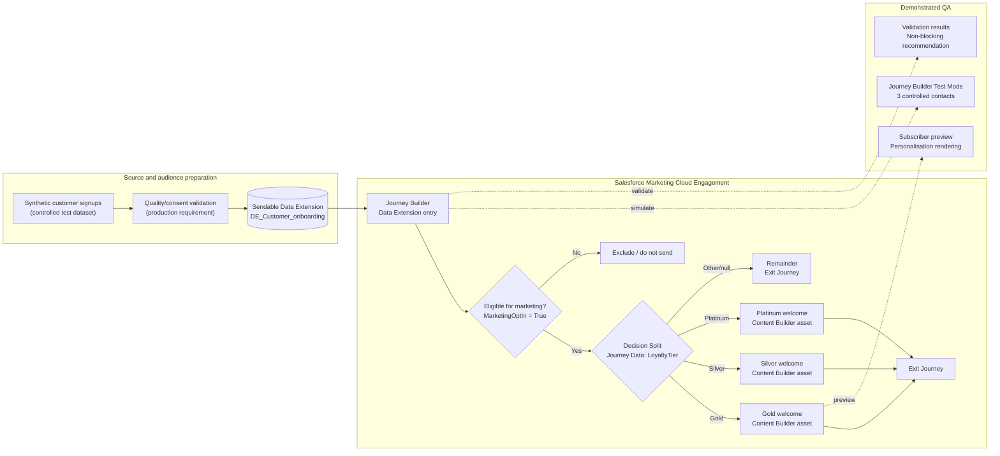
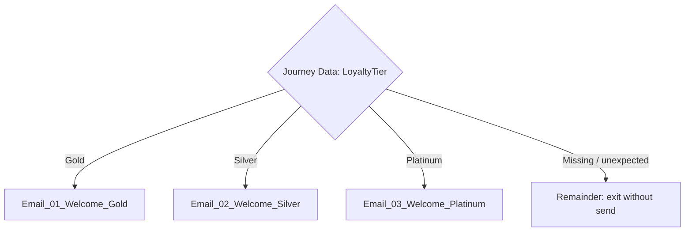
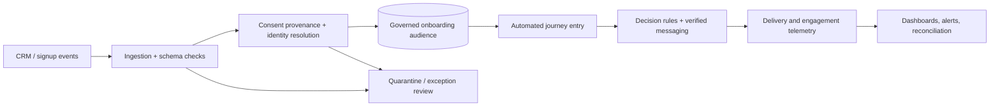

# Architecture and engineering decisions

## 1. Scope and implementation boundary

**Observed / configured in Salesforce Marketing Cloud Engagement:** sendable-customer Data Extension usage, 3 imported sample records, Journey Builder Data Extension entry source, one-time schedule, 3-path loyalty Decision Split, a Remainder exit, 3 Email activities, three Message Definitions, Content Builder previews, and Journey Builder test simulations.

**Designed but not independently demonstrated:** the final opt-in entry filter, data provenance/audit fields, automatic new-signup ingestion, production alerting, high-volume operation, click tracking instrumentation, and governance workflows. These are production hardening requirements—not claims about current deployment.

## 2. Logical component architecture

Dashed arrows represent evidence activities, not actual live sends. The eligibility node is the intended design; confirm that the configured entry filter matches this rule.

## 3. Entry and identity design

- **Data Extension:** `DE_Customer_onboarding`.
- **Primary identity:** `CustomerID` (intended unique, non-null key).
- **Sendable relationship:** map `CustomerID` to Subscriber Key; validate that the business unit's actual Send Relationship matches.
- **Email field:** `EmailAddress`. Mutable contact detail, not preferred permanent identity.
- **Audience eligibility:** intended condition `MarketingOptIn = True` *plus* subscription and suppression checks. A Boolean cannot by itself establish lawful consent.
- **Schedule:** Version 2 screenshot displays **November 12, 2026, 9:30 AM in AUS Eastern Standard Time**, Run Once. This is a configuration snapshot, not proof of execution. AEST is UTC+10; Melbourne is on AEDT UTC+11 in November.
- **Re-entry:** not verified in screenshots; must be reviewed together with cross-version behavior before activation.

## 4. Decision routing

All three positive branches were observed using Journey Builder simulation. Remainder is visible on the canvas but has not been separately tested using an invalid-tier sample.

## 5. Message mapping and personalization

| Journey activity | Attached message | Subject |
| --- | --- | --- |
| `Email_01_Welcome_Gold` | `Welcome_Email_Gold` | Welcome to ACME Gold Rewards! |
| `Email_02_Welcome_Silver` | `Welcome_Email_Silver - 20261104_111803` | Welcome to ACME Silver Rewards! |
| `Email_03_Welcome_Platinum` | `Welcome_Email_Platinum - 20261104_111803 - 20261104_112351` | Welcome to ACME Platinum Rewards! |

The source email example uses a Marketing Cloud personalisation string `%%FirstName%%`, tested in Subscriber Preview. The three messages include tier-specific copy. Preview is independent from send execution.

## 6. Failure modes and intended controls

| Scenario | Behavior seen / desired | Production control |
| --- | --- | --- |
| Unknown or null LoyaltyTier | Remainder exits without message (designed) | Monitor exceptions; correct source, retry only after approval |
| MarketingOptIn false or unknown | Should be excluded by entry filter | Verify filter, consent record, unsubscribe and suppression enforcement |
| Duplicate CustomerID | Should not create competing identities | Enforce uniqueness upstream / reject duplicate file rows |
| Email changes | Subscriber Key remains stable | Update email address on the correct contact identity |
| Missing FirstName | Rendering fallback not demonstrated | AMPscript or attribute fallback with tests |
| CTA URL points to placeholder | No valid destination evidenced | Validate approved URL and tracking |
| Schedule/timezone mismatch | AEST snapshot in November | Explicit local conversion, approved scheduling, dry run |
| Repeated entry across versions | Not evaluated | Document re-entry policy and repeat-send safeguards |
| Unexpected send volume | Three-record demo only | Suppression, throttling/capacity, send monitoring and approvals |
| Privacy leak through screenshots | Public repository risk | Redact PII, internal IDs, account links and tracking identifiers |

## 7. Production target-state (future work)

This is **not deployed** as part of the current portfolio. It illustrates a pathway to operate the journey at production scale.

## 8. Engineering tradeoffs

1. **Split by tier rather than one shared dynamic email.** More explicit control and easy screenshots; cost is three messages to maintain and test.
2. **Remainder exits.** Avoids accidental sends to unsupported tiers but requires exception reporting in production.
3. **Run Once for demonstration.** Deterministic small-cohort testing but insufficient for continuous onboarding.
4. **Journey Data for tier value.** Stable snapshot at entry; if tier changes must affect in-flight contacts, review Contact Data and decision semantics.
5. **No automatic activations.** Separates validated draft state from sending authorization.
