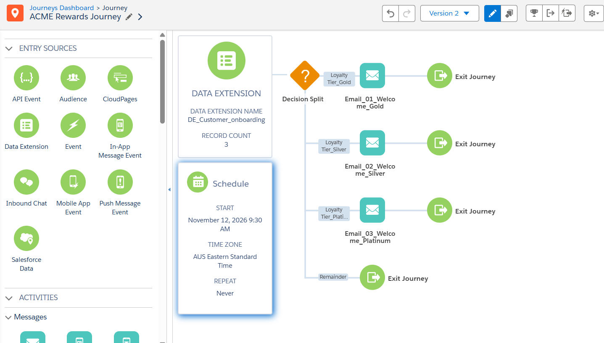

# Salesforce Marketing Cloud | Marketing Automation Portfolio

**Hands-on CRM lifecycle marketing, audience segmentation and personalised journey design**

This repository presents realistic business scenarios built with **Salesforce Marketing Cloud Engagement**. Projects are documented as case studies with architecture, configuration decisions, synthetic data, screenshots and test evidence. Every project distinguishes features actually configured and tested from recommended production hardening.

## Featured project: ACME Rewards Customer Onboarding

**[Explore the complete customer onboarding case study →](01-customer-onboarding/README.md)**

| Capability | Demonstrated evidence |
| --- | --- |
| Audience management | Sendable Data Extension used for a three-contact synthetic cohort |
| Journey orchestration | Loyalty-based Gold / Silver / Platinum Decision Split |
| Message personalisation | Subscriber previews with first name and tier-specific email copy |
| Technical configuration | Three Email activities verified against their Content Builder Message Definitions |
| Quality assurance | **3/3** selected customer routes passed in Journey Builder Test Mode |
| Documentation | Architecture, schema reference, sample CSV, test plan and screenshots |

> **Scope note:** 100% refers only to three simulated routing assertions. This is a controlled **portfolio implementation**, not a production campaign or proof of real email delivery.

### Start here

- **[Project README](01-customer-onboarding/README.md)** — business case, implementation and results
- **[Architecture and design decisions](01-customer-onboarding/architecture/ARCHITECTURE.md)** — renderable Mermaid diagrams, controls and target state
- **[Technical configuration](01-customer-onboarding/technical/DATA_MODEL_AND_CONFIGURATION.md)** — eight-field schema, entry rules, identity and email mappings
- **[Synthetic dataset](01-customer-onboarding/sample-data/test-customers.csv)** — safe `example.com` records
- **[Test plan](01-customer-onboarding/testing/TEST_PLAN.md)** and **[test evidence](01-customer-onboarding/testing/TEST_EVIDENCE.md)** — positive tests, negative cases and release readiness
- **[Screenshots](01-customer-onboarding/screenshots)** — Salesforce configuration and test evidence

## Planned portfolio expansion

- SQL-based customer segmentation and audience automation
- Abandoned cart recovery
- Re-engagement / win-back customer journeys
- Campaign analytics and reporting

The above are **planned project ideas**, not completed implementations.

## Security and confidentiality

The public code/sample files use synthetic customer information only. Actual test inbox addresses, business unit identifiers, sender metadata and other private values should be redacted from screenshots. Do not commit production credentials or subscriber exports.

## Disclaimer

ACME Rewards is a fictional demonstration brand. This is a personal learning and portfolio project, not a claim of work performed for the brand or a production deployment.
